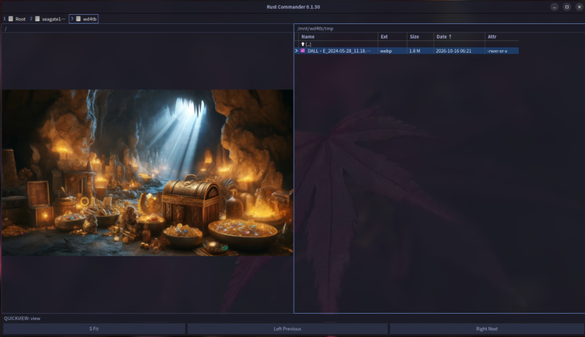
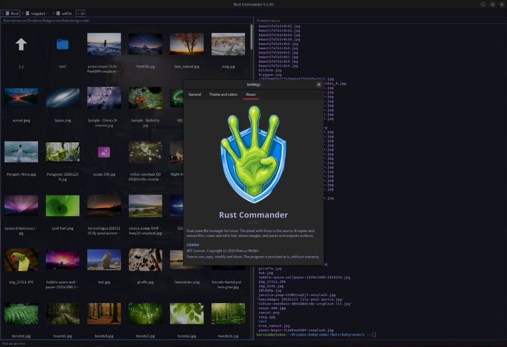
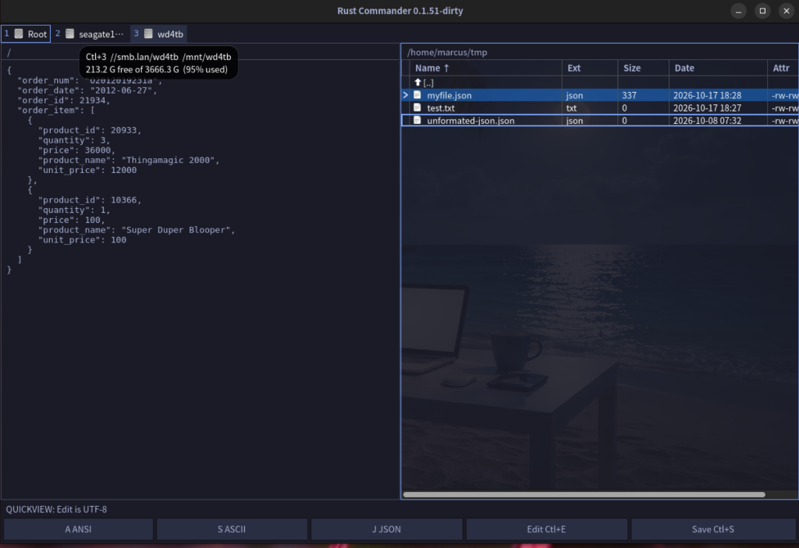

<p align="center"></p>
<h1 align="center">Rust Commander</h1>

<p align="center">
  <a href="LICENSE"></a>
  <a href="https://github.com/gr3p/rust-commander/releases/latest"></a>
</p>

A dual-pane file manager for Linux, in the tradition of Total Commander on Windows and Midnight Commander in the terminal. It keeps the keyboard-driven F-key workflow and adds a native GTK4 window written in Rust, built-in terminals, image and text viewers, and themes that follow your desktop. On [Omarchy](https://omarchy.org) it restyles itself when you change theme.

Early release (0.1.x): expect rough edges, and please [report them](https://github.com/gr3p/rust-commander/issues).

<table>
  <tr>
    <td></td>
    <td></td>
    <td></td>
  </tr>
  <tr align="center">
    <td>Two panels</td>
    <td>Quick view</td>
    <td>Thumbnails</td>
  </tr>
</table>

## Features

- **Built for the keyboard.** Two panels and the F-key workflow you know from Total Commander, so everyday file work takes a few keystrokes.

- **Fast and native.** Written in Rust as a single binary of about 10 MB, with no runtime to start. The first folder is listed in about a tenth of a second, folders load in the background, and copy and move keep running while you work.

- **Easy on memory with big files.** Files are streamed in 1 MiB chunks and the viewer reads only the part on screen, so a multi-gigabyte file costs no more memory than a small one.

- **Find anything.** Search by name or by what is inside your files, and filter the list as you type.

- **See before you open.** Preview text, images and thumbnails right next to your files, and edit in place.

- **Archives without the fuss.** Pack and unpack zip, 7z, rar and tar, and verify files with checksums.

- **A terminal at hand.** Open real shells beside your files and jump between them.

- **A command bar that adapts.** It offers the commands that fit what is under the cursor.

- **Looks like your desktop.** Ships with popular themes, and follows Omarchy when you change theme.



## Install

**Arch and Omarchy**

```bash
yay -S rust-commander
```

**Ubuntu 26.04** (amd64)

Add the repository once. apt then installs Rust Commander and pulls in GTK4 and VTE.

```bash
sudo install -d -m 0755 /etc/apt/keyrings
curl -fsSL https://gr3p.github.io/rust-commander/rust-commander.gpg | sudo tee /etc/apt/keyrings/rust-commander.gpg >/dev/null
sudo tee /etc/apt/sources.list.d/rust-commander.sources >/dev/null <<'EOF'
Types: deb
URIs: https://gr3p.github.io/rust-commander
Suites: resolute
Components: main
Architectures: amd64
Signed-By: /etc/apt/keyrings/rust-commander.gpg
EOF
sudo apt update
sudo apt install rust-commander
```

Without the repository, download the `.deb` from the [Releases page](https://github.com/gr3p/rust-commander/releases/latest) and run `sudo apt install ./rust-commander_*_amd64.deb`.

**Fedora 44** (x86_64)

Add the repository once. dnf then installs Rust Commander and pulls in GTK4 and VTE.

```bash
sudo dnf config-manager addrepo --from-repofile=https://gr3p.github.io/rust-commander/rpm/rust-commander.repo
sudo dnf install rust-commander
```

Start it from the application menu, or run `rust-commander`. To remove it: `sudo apt remove rust-commander`, `yay -R rust-commander` or `sudo dnf remove rust-commander`.

For `.7z` and `.rar` archives, also install 7-Zip (`p7zip-full` on Ubuntu, `p7zip` on Arch) and RARLAB `rar`. `.zip` works without them.

## Usage

The panel with focus is the source, the other is the target. Press F1 for all commands and F12 for settings.

| Panels | |
| --- | --- |
| Tab | Switch panel |
| Space / Insert | Mark / mark and move on |
| Ctrl+Right (left panel), Ctrl+Left (right panel) | Open the folder under the cursor in the other panel |
| Ctrl+S | Filter, plain text or wildcards such as `*.md` and `edit?.txt` |
| Ctrl+Shift+S | Search names through all subfolders, also file text, size, date, duplicates and archives |
| Ctrl+F3 to Ctrl+F6 | Sort |
| Ctrl+H | Show or hide dotfiles |
| Ctrl+Shift+F1 | Thumbnail grid |

| Files | |
| --- | --- |
| F5 / F6 | Copy / move to the other panel |
| Shift+F5 / Shift+F6 | Copy under a new name / rename |
| F7 / Shift+F7 | Make a folder / make a symbolic or hard link |
| F8 / Shift+F8 | Send to the trash / delete for good |
| Ctrl+Delete | Overwrite once, then delete |
| Alt+Enter | Properties and permissions, and folder size |

| View and edit | |
| --- | --- |
| F3 | View text, binary, hex, or pretty JSON in UTF-8, ANSI or ASCII. Images open in their own window |
| Ctrl+E | Edit in place |
| Ctrl+Q | Quick view in the other panel, editable |
| F4 | Open the editor you pick in F12 |

| Archives and checksums | |
| --- | --- |
| Alt+F5 | Pack the selection to `.zip`, `.7z` or `.rar` |
| Alt+F9 / Shift+Alt+F9 | Unpack into the other panel / where the archive is |
| Ctrl+Shift+F2 | Test an archive without unpacking |
| Shift+F9 | Write a `.sfv`, `.md5`, `.sha1` or `.sha256`. Enter on one checks it |
| Ctrl+Shift+F7 | Encode or decode Base64, UUE and MIME into the other panel |

| Terminal | |
| --- | --- |
| F9 | Open a terminal in the other panel at the active panel's directory. F9 again hides it without stopping it |
| Ctrl+F9 | Open another terminal |
| Alt+1 to Alt+9 | Switch between terminals |

Broken files are skipped and listed when unpacking finishes, and a missing rar volume is named. An archive is unpacked, it is not opened as a folder.

## Configuration

Settings (F12) has two tabs: General, and Theme and colors. The log is written to `~/.local/state/rust-commander/rust-commander.log`.

### Themes

The theme is the base for fonts and colors. The Theme dropdown starts with `omarchy`, the default, then the built-in themes, then any theme under `~/.config/omarchy/themes` or `/usr/share/omarchy/themes` (a user theme with the same name wins). Picking one saves it to `config.toml` and to `~/.config/rust-commander/active-theme`. Adding a built-in theme is one entry in `src/theme.rs`.

Under Colors you can override the background color, the cursor color, the cursor text color (the text on the cursor bar only) and the mark color (files marked with Space). Each has a Reset that hands it back to the theme. Your own colors stay when you switch theme; a dialog says so and lets you drop them.

### Omarchy

With `omarchy` selected the window reads `~/.local/state/omarchy/current/theme/colors.toml` (the same names, aliases and light/dark mode as `omarchy-theme-color`) and restyles by itself when `omarchy theme set` rewrites `current/theme.name`. No hook is needed. It also follows:

- `current/theme/shell.toml`: selected and hover row fills (`[controls]`), the active pane border (`[hyprland] active-border`), font size (`[font] base-size`) and padding (`[spacing]`).
- Hyprland's `decoration:rounding` for corner radius, and the `monospace` fontconfig alias that `omarchy font set` writes.
- `current/theme/icons.theme` through the "Omarchy (follows theme)" icon pack.

`omarchy/theme-set` is an optional hook that only sends SIGUSR1 to force a reload.

## Build from source

Install the build dependencies. Omarchy is Arch-based and needs no extra packages.

```bash
# Ubuntu / Debian
sudo apt install build-essential pkg-config libgtk-4-dev libvte-2.91-gtk4-dev

# Arch / Omarchy
sudo pacman -S --needed base-devel pkgconf gtk4 vte4

# Fedora
sudo dnf install cargo rust pkgconf-pkg-config gcc gtk4-devel vte291-gtk4-devel
```

```bash
cargo run --release
```

If `cargo build` fails on `vte-2.91-gtk4`, install the VTE GTK4 package from the commands above. Packing `.7z` and `.rar` needs 7-Zip and RARLAB `rar` (`unrar` does not pack). The `.desktop` file is in `data/rust-commander.desktop`.

See [CONTRIBUTING.md](CONTRIBUTING.md) for how to test a change.

## License

[MIT](LICENSE)
