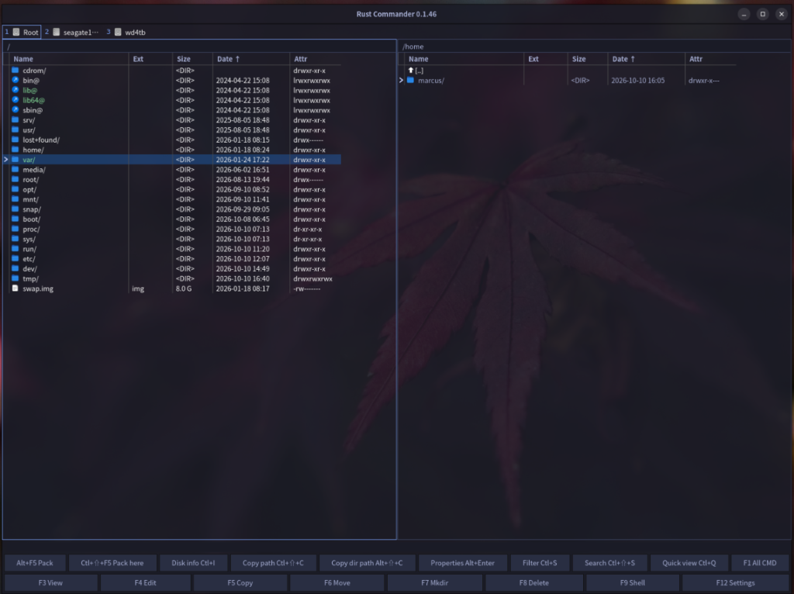

#  Rust Commander

A dual-pane file manager for Linux, in the tradition of Total Commander on Windows and Midnight Commander in the terminal. It keeps the keyboard-driven F-key workflow and adds a native GTK4 window written in Rust, built-in terminals, image and text viewers, and themes that follow your desktop.



## Install

**Arch and Omarchy**

```bash
yay -S rust-commander
```

**Ubuntu and Debian**

1. Download the newest `rust-commander_<version>_amd64.deb` from the [Releases page](https://github.com/gr3p/rust-commander/releases/latest).
2. Install it from the folder where it was saved. apt pulls in GTK4 and VTE for you.

```bash
sudo apt install ./rust-commander_*_amd64.deb
```

Start it from the application menu, or run `rust-commander`.

For `.7z` and `.rar` archives, also install 7-Zip (`p7zip-full` on Ubuntu, `p7zip` on Arch) and RARLAB `rar`. `.zip` works without them.

## What it does

**Two panels, one source.** The panel with focus is the source, the other is the target. F5 copies, F6 moves, F7 makes a folder, F8 sends to the trash and Shift+F8 deletes for good. Each panel has tabs, history, bookmarks, a drive list with free space on hover, and a disk info window with file system, UUID, mount options and inodes. Tab switches panel, Space marks and Insert marks and moves on. Ctrl+Right from the left panel, or Ctrl+Left from the right, opens the folder under the cursor in the other panel. Marking it first is not required.

**Copy and move.** Copies and moves can wait in a queue and show progress. A copy never leaves a half-written file under the real name: it writes to a temporary file and renames it when complete. Shift+F5 copies under a new name, Shift+F6 renames, Shift+F7 makes a symbolic or hard link, and Ctrl+Delete overwrites a file once before deleting it. Alt+Enter shows properties and permissions, and can calculate the size of a folder.

**Find and filter.** Ctrl+S filters the panel, with plain text or wildcards such as `*.md` and `edit?.txt`. Ctrl+Shift+S searches names through all subfolders. Search can also look inside file text, limit by size and date, find duplicates, look inside archives, and show the hits in a panel. Sorting is on Ctrl+F3 to Ctrl+F6, and Ctrl+H shows or hides dotfiles. Ctrl+Shift+F1 switches to a thumbnail grid.

**View and edit.** F3 opens text as text, binary or hex, in UTF-8, ANSI, ASCII or pretty JSON. Ctrl+E edits it in place, with cut, copy, paste and save. Images open in their own window and arrow keys step through the folder. Ctrl+Q previews the file under the cursor in the other panel, and edits it there too. F4 opens the editor you pick in F12.

**Archives.** Alt+F5 packs the selection to `.zip`, `.7z` or `.rar`, and Alt+F9 unpacks zip, rar and tar into the other panel. Shift+Alt+F9 extracts where the archive is. Broken files are skipped and listed when unpacking finishes, and a missing rar volume is named. Ctrl+Shift+F2 tests an archive without unpacking it. An archive is unpacked, it is not opened as a folder.

**Checksums and encoding.** Shift+F9 writes a `.sfv`, `.md5`, `.sha1` or `.sha256` for the selection, and Enter on one checks it. Ctrl+Shift+F7 encodes or decodes Base64, UUE and MIME into the other panel.

**Shell.** F9 opens a real terminal in the other panel, in the active panel's directory, and F9 again hides it without stopping it. Ctrl+F9 opens another one. Each is a numbered button, and Alt+1 to Alt+9 switches between them.

**Command bar.** The button row above the F keys shows the commands you are most likely to want for what is under the cursor, so an archive offers unpack. F1 (All CMD) lists the rest, and F12 holds the settings.

**Themes.** Built-in themes are Tokyo Night, Catppuccin Mocha, Gruvbox Dark and Nord. On Omarchy the window follows the active Omarchy theme and restyles by itself when you change it.

## Build on Linux

```bash
# Ubuntu / Debian
sudo apt install build-essential pkg-config libgtk-4-dev libvte-2.91-gtk4-dev

# Arch / Omarchy
sudo pacman -S --needed base-devel pkgconf gtk4 vte4
```

```bash
cargo run --release
```

`.7z` and `.rar` packing need 7-Zip and RARLAB `rar` (`unrar` does not pack), as under Install. `bubblewrap` is only needed for `scripts/test-sandbox.sh`, not to build or start the program. Omarchy does not need to be installed; it uses the same Arch packages.

If `cargo build` fails on `vte-2.91-gtk4`, install the VTE GTK4 package from the commands above.

The log is written to `~/.local/state/rust-commander/rust-commander.log`.

Try copy, move, and delete in a scratch directory, for example `~/rust-commander-prov` with two subdirectories.

1. Open the left panel in one folder and the right panel in the other.
2. F5 copies a file and a folder with contents to the right.
3. F6 moves a file back.
4. F7 creates a folder. Shift+F6 renames it.
5. F8 moves a file to the trash. Restore it from the trash if you want to see that it is not really gone.
6. F3 shows a text file, or an image in its own window. Ctrl+Q previews in the other panel. Left and right change the image in that folder.
7. Close and start again. The window comes back.

## Themes

The theme is the base for fonts and colors. Settings (F12) has two tabs: General, and Theme and colors. Under Colors you can override the background color, the cursor color, the cursor text color (the text on the cursor bar only) and the mark color (files marked with Space). Each has a Reset that hands it back to the theme. A theme also brings its own cursor color and cursor text color. Your own colors stay when you switch theme; a dialog says so and lets you drop them.

Settings (F12) has a Theme dropdown. The first entry, `omarchy`, follows the theme Omarchy has applied: it reads `~/.local/state/omarchy/current/theme/colors.toml` (the same names, aliases and light/dark mode as `omarchy-theme-color`) and is the default. Next come the built-in themes, then any theme under `~/.config/omarchy/themes` or `/usr/share/omarchy/themes` (a user theme with the same name wins). Picking one saves it to `config.toml` and to `~/.config/rust-commander/active-theme`. Adding a built-in theme is one entry in `src/theme.rs`.

## Omarchy

Omarchy is Arch-based, so use the pacman build packages above. With `omarchy` selected the window restyles by itself when `omarchy theme set` rewrites `current/theme.name`; no hook is needed. It also follows:

- `current/theme/shell.toml`: selected and hover row fills (`[controls]`), the active pane border (`[hyprland] active-border`), font size (`[font] base-size`) and padding (`[spacing]`).
- Hyprland's `decoration:rounding` for corner radius, and the `monospace` fontconfig alias that `omarchy font set` writes.
- `current/theme/icons.theme` through the "Omarchy (follows theme)" icon pack.

`omarchy/theme-set` is an optional hook that only sends SIGUSR1 to force a reload.

The `.desktop` file is in `data/rust-commander.desktop`.
