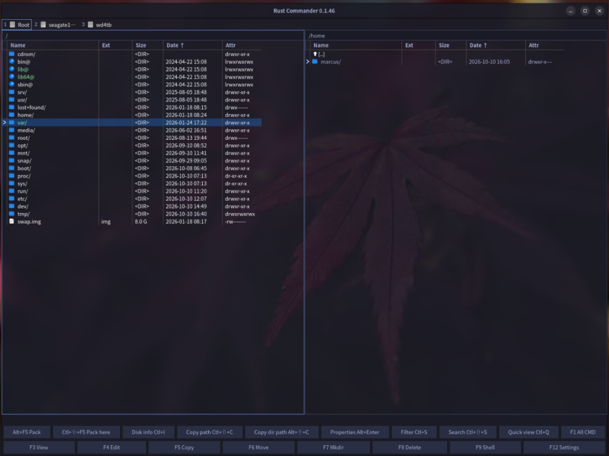
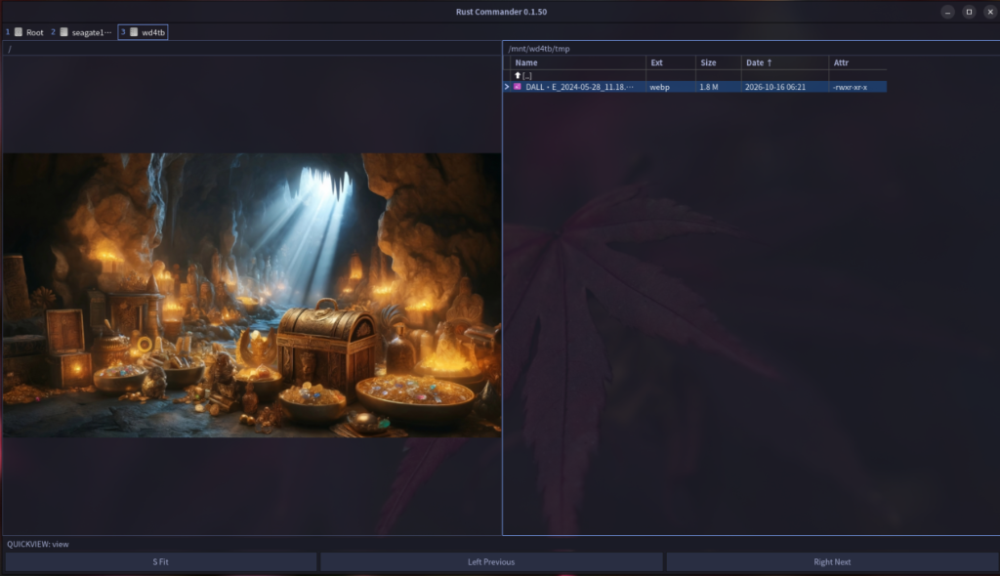
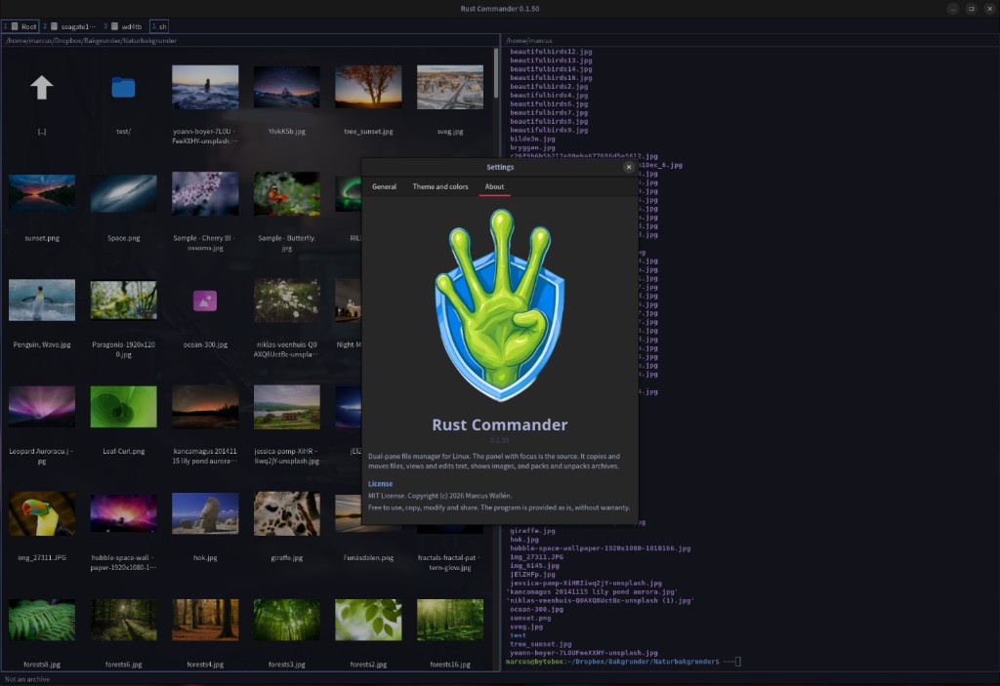
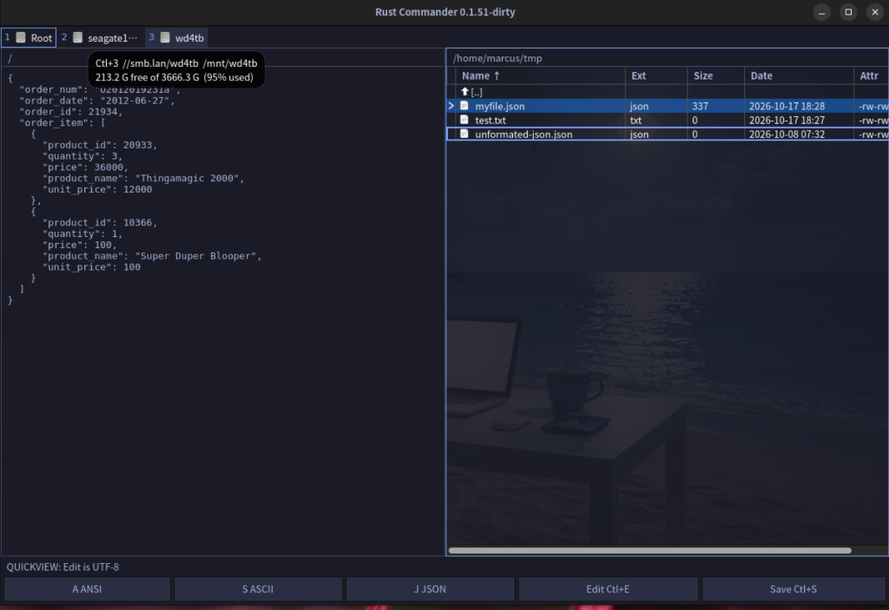
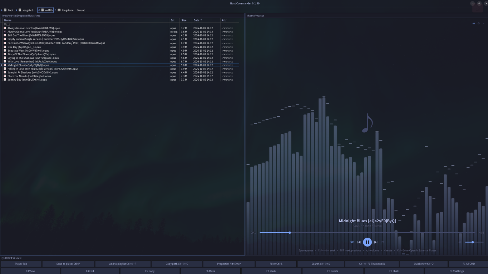

<p align="center"></p>
<h1 align="center">Rust Commander</h1>

<p align="center">
  <a href="LICENSE"></a>
  <a href="https://github.com/gr3p/rust-commander/releases/latest"></a>
</p>

A dual-pane file manager for Linux, in the tradition of Total Commander on Windows and Midnight Commander in the terminal. It keeps the keyboard-driven F-key workflow and adds a native GTK4 window written in Rust, built-in terminals, image and text viewers, and themes that follow your desktop. On [Omarchy](https://omarchy.org) it restyles itself when you change theme.

Early release (0.2): expect rough edges, and please [report them](https://github.com/gr3p/rust-commander/issues).

<table>
  <tr>
    <td></td>
    <td></td>
    <td></td>
  </tr>
  <tr align="center">
    <td>Two panels</td>
    <td>Quick view</td>
    <td>Thumbnails</td>
  </tr>
</table>

## Features

- **Built for the keyboard.** Two panels and the F-key workflow you know from Total Commander, so everyday file work takes a few keystrokes.

- **Fast and native.** Written in Rust as a single binary of about 10 MB, with no runtime to start. The first folder is listed in about a tenth of a second, folders load in the background, and copy and move keep running while you work.

- **Easy on memory with big files.** Files are streamed in 1 MiB chunks and the viewer reads only the part on screen, so a multi-gigabyte file costs no more memory than a small one.

- **Find anything.** Search by name or by what is inside your files, and filter the list as you type.

- **See before you open.** Preview text, images and thumbnails right next to your files, and edit in place.

- **Music built in.** Press Ctrl+Q on a song and it plays in the other panel, with its cover, tags, a seek bar, volume and a visualizer in your theme's colors. The playlist is the folder, or the songs you marked and sent from the right-click menu, with next, previous, shuffle and repeat. Fold it into a small player under a panel and keep working. mp3, flac, ogg, opus, wav, aac, m4a and aiff are decoded by the program itself and played through ALSA, so PipeWire and PulseAudio work. The keys are under Music below.

- **Archives without the fuss.** Pack and unpack zip, 7z, rar and tar, and verify files with checksums.

- **A terminal at hand.** Open real shells beside your files and jump between them.

- **A command bar that adapts.** It offers the commands that fit what is under the cursor.

- **Looks like your desktop.** Ships with popular themes, and follows Omarchy when you change theme.

## Edit support



<br>

## Music Player support

A music player that lives in your file manager. Press Ctrl+Q on a song and keep working while it plays. mp3, flac, ogg, opus, wav, aac, m4a and aiff are decoded by the program itself, with no extra player to install. You get the cover from the tags or from a `cover.jpg` in the folder, a visualizer in your theme's colors (bars, wave, radial or ribbon), and playlists from the folder or from the songs you mark. Shuffle, repeat and the media keys work, and the small player stays under a panel while you copy, move and browse.



<br>

## Install

**Arch and Omarchy** (x86_64)

Add the repository once. pacman then installs Rust Commander, and later system updates, including `omarchy update`, keep it current.

```bash
curl -fsSL https://gr3p.github.io/rust-commander/pubkey.asc | sudo pacman-key --add -
sudo pacman-key --lsign-key 0803B713F76C8CFB8CBD3C95B203CAEB2B841D3A
curl -fsSL https://gr3p.github.io/rust-commander/arch/rust-commander.conf | sudo tee -a /etc/pacman.conf >/dev/null
sudo pacman -Sy
sudo pacman -S rust-commander
```

**Ubuntu 26.04** (amd64)

Add the repository once. apt then installs Rust Commander and pulls in GTK4 and VTE.

```bash
sudo install -d -m 0755 /etc/apt/keyrings
curl -fsSL https://gr3p.github.io/rust-commander/rust-commander.gpg | sudo tee /etc/apt/keyrings/rust-commander.gpg >/dev/null
sudo tee /etc/apt/sources.list.d/rust-commander.sources >/dev/null <<'EOF'
Types: deb
URIs: https://gr3p.github.io/rust-commander
Suites: resolute
Components: main
Architectures: amd64
Signed-By: /etc/apt/keyrings/rust-commander.gpg
EOF
sudo apt update
sudo apt install rust-commander
```

Without the repository, download the `.deb` from the [Releases page](https://github.com/gr3p/rust-commander/releases/latest) and run `sudo apt install ./rust-commander_*_amd64.deb`.

**Fedora 44** (x86_64)

Add the repository once. dnf then installs Rust Commander and pulls in GTK4 and VTE.

```bash
sudo dnf config-manager addrepo --from-repofile=https://gr3p.github.io/rust-commander/rpm/rust-commander.repo
sudo dnf install rust-commander
```

Start it from the application menu, or run `rust-commander`. To remove it: `sudo pacman -R rust-commander`, `sudo apt remove rust-commander` or `sudo dnf remove rust-commander`.

Music plays through ALSA, which PipeWire and PulseAudio answer to, so it works with the sound setup you already have. The package asks for `libasound2` and, for Opus files, `libopus0`. Without them the player says so and everything else works as before.

For `.7z` and `.rar` archives, also install 7-Zip (`p7zip-full` on Ubuntu, `p7zip` on Arch) and RARLAB `rar`. `.zip` works without them.

## Usage

The panel with focus is the source, the other is the target. Press F1 for all commands and F12 for settings.

| Panels | |
| --- | --- |
| Tab | Switch panel |
| Space / Insert | Mark / mark and move on |
| Ctrl+Right (left panel), Ctrl+Left (right panel) | Open the folder under the cursor in the other panel |
| Ctrl+S | Filter, plain text or wildcards such as `*.md` and `edit?.txt` |
| Ctrl+Shift+S | Search names through all subfolders, also file text, size, date, duplicates and archives |
| Ctrl+F3 to Ctrl+F6 | Sort |
| Ctrl+H | Show or hide dotfiles |
| Ctrl+Shift+F1 | Thumbnail grid |
| Super+Up / Super+Down | Maximize the window / restore it, as in other GNOME windows. If your window manager already has its own binding for these keys, it handles them first |

| Files | |
| --- | --- |
| F5 / F6 | Copy / move to the other panel |
| Shift+F5 / Shift+F6 | Copy under a new name / rename |
| F7 / Shift+F7 | Make a folder / make a symbolic or hard link |
| F8 / Delete | Send to the trash |
| Ctrl+Delete / Shift+F8 | Delete for good |
| Ctrl+Shift+Delete | Overwrite once, then delete |
| Alt+Enter | Properties and permissions, and folder size |

| View and edit | |
| --- | --- |
| F3 | View text, binary, hex, or pretty JSON in UTF-8, ANSI or ASCII. Images open in their own window |
| Ctrl+E | Edit in place |
| Ctrl+Q | Quick view in the other panel, editable |
| F4 | Open the editor you pick in F12 |

| Music (the big player in the quick view) | |
| --- | --- |
| Ctrl+Q on a song | The song starts playing in the other panel at once, and the playlist is the music files of that folder in the order the list shows them. Ctrl+Q again closes the quick view and stops the music |
| Enter on a song | Plays that song. With nothing playing it starts the big player, and the quick view opens with it. With the quick view on a song and nothing playing, the player waits for Enter |
| Tab | The keys go to the player, and Tab again hands them back to the file panel. The player is outlined while it has them |
| Space (or the media key) | Play or pause. Press it after the song has ended to play it again |
| Ctrl+Left / Ctrl+Right | Seek 5 seconds back or forward, 30 seconds with Shift. The seek bar and volume also work with the mouse |
| N / P (or the next and previous media keys) | Next and previous song. The cursor moves to it. P inside the first 3 seconds goes to the song before, later it starts the song again |
| S / R | Shuffle on or off. Repeat off, all, one. Both are remembered |
| + / − | Volume |
| M | Mute |
| Ctrl+M | Minimize the player (see below) |
| Escape | Hand the keys back to the file panel |
| Ctrl+Enter | Open In External Player: your default player opens the file and the built-in one pauses. A format the built-in player cannot read, such as WMA, says so and waits for Ctrl+Enter |

The player keys (Space, the letters, +/− and the arrows) work while the player has the keys, so Space marks files as usual while the file panel has them. The media keys work all the time.

Moving the cursor never changes the song. It changes when you press Enter on another song, when you press N or P, and when a song ends. The big player keeps the quick view pane even if the cursor goes to a text file, until you press Ctrl+Q or minimize it.

The cover is the one inside the file. Without one, the player looks for a picture in the folder called `cover`, `folder`, `front`, `albumart`, `album` or `poster` (jpg, png and so on), and shows it for every song there. `back`, `inlay` and `disc` pictures are skipped.

The cover is shown square and never larger than about 38 % of the window's shorter side, and it shrinks to fit when there is little room.

The visualizer plays behind the whole player and follows the sound itself. The small buttons in the top corner switch it on or off, open the cogwheel to pick a style (Bars, Wave, Radial or Ribbon) and minimize the player. The same choices are in F12 on the Music tab.

| Playlists from marked songs | |
| --- | --- |
| Right-click, Send and replace music in player (or Ctrl+P) | The marked songs of the panel become the playlist, in the order the list shows them, and the first one plays. With nothing marked, the song under the cursor is sent. A right-click on a row that is not marked sends only that row and leaves the marks |
| Right-click, Add to current playlist (or Ctrl+Shift+P) | The songs go last in the playlist that is playing. Songs already in it are not added twice. With nothing playing they start a playlist |

The songs go to the player that is open: the small one if the small player is up, the big one if it is. With none open they go to the big one, and the quick view opens for it (an editor or a shell in the other panel leaves no room, so the small one starts then). A picked playlist stays as it is, whatever the list shows.

| Small player | |
| --- | --- |
| Minimize button or Ctrl+M | The player folds into a bar under the list it started from, the quick view closes and both lists work as usual. The music plays on, to the end of the folder, and the cursor follows it unless you have moved it away |
| Enter on a song | Plays it in the small player, in any folder and in either panel |
| Ctrl+Q on a song | While the small player is up, a song under the cursor plays there instead of opening the quick view. Ctrl+Q on anything else is the quick view as usual |
| Tab | Left panel, right panel, small player, and round again. The small player blinks when it gets the keys, and the panel blinks when they come back |
| Ctrl+M | Jump to the small player. Ctrl+M again, with the keys in it, makes it big. In the big player Ctrl+M folds it, so Ctrl+M toggles between the two. Escape and any list key give the keys back to the list. Space, Ctrl+Left / Right, N / P (or Up / Down), R, S, + / − and M work on it while it has them |
| X or Delete | Stops the music and closes the small player, while it has the keys |
| Expand button | Back to the big player: the list shows the folder with the cursor on the song, and the quick view opens. The X button stops the music and closes the player |

| Archives and checksums | |
| --- | --- |
| Alt+F5 | Pack the selection to `.zip`, `.7z` or `.rar` |
| Alt+F9 / Shift+Alt+F9 | Unpack into the other panel / where the archive is |
| Ctrl+Shift+F2 | Test an archive without unpacking |
| Shift+F9 | Write a `.sfv`, `.md5`, `.sha1` or `.sha256`. Enter on one checks it |
| Ctrl+Shift+F7 | Encode or decode Base64, UUE and MIME into the other panel |

| Terminal | |
| --- | --- |
| F9 | Open a terminal in the other panel at the active panel's directory. F9 again hides it without stopping it |
| Ctrl+F9 | Open another terminal |
| Alt+1 to Alt+9 | Switch between terminals |

Broken files are skipped and listed when unpacking finishes, and a missing rar volume is named. An archive is unpacked, it is not opened as a folder.

Any job that runs longer than half a second opens a progress window with a Cancel button, also while it is still counting or reading one large file, and so does reading a large archive before it is unpacked. Copying, moving and delete for good count the selection first, and the bar pulses meanwhile. Checksum files and secure delete show their progress in bytes. Delete for good refuses a folder with another disk mounted inside before anything is removed, and secure delete checks the whole selection before the first overwrite.

File writes use uniquely named temporary files. Concurrent jobs cannot write the same destination, and a copy or cross-filesystem move stops with an error if it detects that its source or destination changed. On filesystems without atomic no-replace renames (NFS, NTFS-3g and other FUSE mounts), a file is placed with a hard link and a folder replaces a freshly made empty folder, so a newly created destination is still never overwritten. If the filesystem has no hard links either, an error is returned.

The built-in editor refuses to save a file with multiple hard links or a different owner, or when it cannot create a temporary file beside it. This keeps the original intact instead of falling back to a destructive in-place write. Use a separate copy to edit such a file.

## Configuration

Settings (F12) has two tabs: General, and Theme and colors. The log is written to `~/.local/state/rust-commander/rust-commander.log`.

### Themes

The theme is the base for fonts and colors. The Theme dropdown starts with `omarchy`, the default, then the built-in themes, then any theme under `~/.config/omarchy/themes` or `/usr/share/omarchy/themes` (a user theme with the same name wins). Picking one saves it to `config.toml` and to `~/.config/rust-commander/active-theme`. Adding a built-in theme is one entry in `src/theme.rs`.

Under Colors you can override the background color, the cursor color, the cursor text color (the text on the cursor bar only) and the mark color (files marked with Space). Each has a Reset that hands it back to the theme. Your own colors stay when you switch theme; a dialog says so and lets you drop them.

### Music

The player needs no setup. To play through a particular sound card, name its ALSA device in `RUST_COMMANDER_AUDIO_DEVICE`, for example `plughw:1,0` (see `aplay -L`). It starts at 80 % volume, which is a gentle level on the curve the volume follows, and the volume is not saved between runs. Shuffle, repeat, and the visualizer's on/off and style are saved in `config.toml` (`player_shuffle`, `player_repeat`, `player_visual_on`, `player_visual`).

### Omarchy

With `omarchy` selected the window reads `~/.local/state/omarchy/current/theme/colors.toml` (the same names, aliases and light/dark mode as `omarchy-theme-color`) and restyles by itself when `omarchy theme set` rewrites `current/theme.name`. No hook is needed. It also follows:

- `current/theme/shell.toml`: selected and hover row fills (`[controls]`), the active pane border (`[hyprland] active-border`), font size (`[font] base-size`) and padding (`[spacing]`).
- Hyprland's `decoration:rounding` for corner radius, and the `monospace` fontconfig alias that `omarchy font set` writes.
- `current/theme/icons.theme` through the "Omarchy (follows theme)" icon pack.

`omarchy/theme-set` is an optional hook that only sends SIGUSR1 to force a reload.

## Build from source

Install the build dependencies. Omarchy is Arch-based and needs no extra packages.

```bash
# Ubuntu / Debian
sudo apt install build-essential pkg-config libgtk-4-dev libvte-2.91-gtk4-dev

# Arch / Omarchy
sudo pacman -S --needed base-devel pkgconf gtk4 vte4

# Fedora
sudo dnf install cargo rust pkgconf-pkg-config gcc gtk4-devel vte291-gtk4-devel
```

```bash
cargo run --release
```

The music player needs nothing extra to build: it loads ALSA and libopus when it first plays. If `cargo build` fails on `vte-2.91-gtk4`, install the VTE GTK4 package from the commands above. Packing `.7z` and `.rar` needs 7-Zip and RARLAB `rar` (`unrar` does not pack). The `.desktop` file is in `data/rust-commander.desktop`.

See [CONTRIBUTING.md](CONTRIBUTING.md) for how to test a change.

## License

[MIT](LICENSE)

The music player builds on [Symphonia](https://github.com/pdeljanov/Symphonia) (MPL-2.0, used unchanged, source on crates.io and at that link), which decodes mp3, flac, ogg vorbis, wav, aac, m4a and aiff. At run time it loads ALSA (LGPL-2.1) and libopus (BSD-3-Clause) from your system, so neither is part of the binary.
